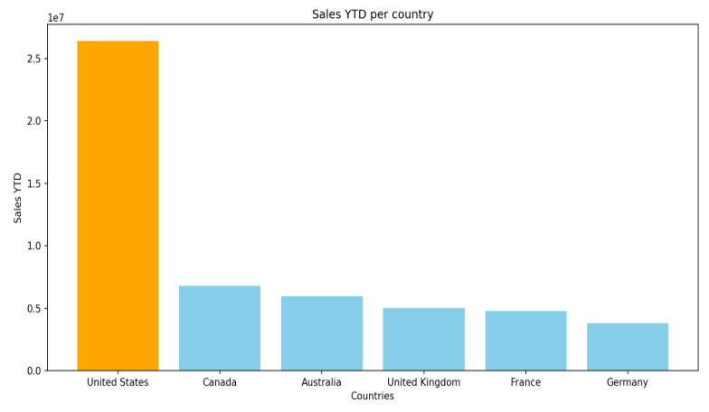

# AdventureWorks retail analysis

SQL and Python analysis of sales territories, workforce measures and store demographics in AdventureWorks2019. This was a group project completed during the Generation UK & Ireland Data Analytics Programme.

The project connects business questions to SQL queries and visual evidence: which territories contribute most sales, how workforce measures vary, and how store size relates to reported revenue. It is exploratory analysis of a sample database, not a forecast or evidence that changing staffing causes revenue growth.



## Explore the work

- [Detailed analysis and existing charts](adventureworks-retail-analysis/README.md)
- [Six SQL scripts](adventureworks-retail-analysis/sql)
- [Six Python visualisation scripts](adventureworks-retail-analysis/python)
- [Database and export setup](adventureworks-retail-analysis/data/DATASET_SETUP.md)

The original project remains in its existing subfolder so established file paths are preserved.

## Reproduce the analysis

You need SQL Server with AdventureWorks2019 restored, SQL Server Management Studio or an equivalent query client, and Python with the packages in the existing requirements file. No API keys are needed.

From the repository root:

```bash
cd adventureworks-retail-analysis
python -m venv .venv
```

Activate with `.venv\Scripts\Activate.ps1` in PowerShell or `source .venv/bin/activate` on macOS/Linux, then:

```bash
python -m pip install -r requirements.txt
```

Run the SQL queries and save their results with headers in this working directory. The first five inputs are **tab-delimited despite their .csv extensions**; the sixth is comma-delimited.

| SQL file in `sql/` | Input filename | Separator | Python file in `python/` |
| --- | --- | --- | --- |
| `01_revenue_by_country.sql` | `question1_part1.csv` | Tab | `01_sales_by_country.py` |
| `02_us_regional_sales.sql` | `question1_part2.csv` | Tab | `02_us_regional_sales.py` |
| `03_vacation_vs_bonus.sql` | `question2.csv` | Tab | `03_vacation_vs_bonus.py` |
| `04_sick_leave_analysis.sql`, query D | `avgsickleave.csv` | Tab | `04_sick_leave_by_department.py` |
| `05_store_duration_vs_revenue.sql` | `question5.csv` | Tab | `05_store_duration_vs_revenue.py` |
| `06_store_size_employees_revenue.sql` | `q6.csv` | Comma | `06_store_size_employees_revenue.py` |

For example, after preparing `question1_part1.csv`:

```bash
python python/01_sales_by_country.py
```

The scripts display plots; they do not automatically recreate every committed PNG. Keep the SQL column names unchanged when exporting. See the setup guide for expected headers.

## Interpretation and validation

Country and regional queries use `SalesYTD`, while the store queries use `AnnualRevenue` from store demographics. These are different measures and should not be combined as if they describe the same period. The store-duration query uses an explicit 2019 reference-year assumption; a database release name alone does not establish an observation date. `SickLeaveHours` records available leave hours, not proven sickness absence. Correlations do not establish causation.

The October 2026 review checked script syntax, SQL-to-Python column mappings and local documentation links. The database and query exports were unavailable, so the SQL and visualisation pipeline were not rerun against the original data. There is no automated test suite in this repository.

## Contribution and reuse

Hasan Naimul contributed to this group analysis. The retained group report and presentation identify the team; this repository does not establish individual ownership of every query, chart or conclusion. No unverified division of responsibilities is claimed.

The existing [MIT licence](adventureworks-retail-analysis/LICENSE) is unchanged. Dataset terms and rights in group materials need to be checked separately before redistributing them. Future improvements include verified source acquisition instructions and reproducible, permission-cleared query exports.
